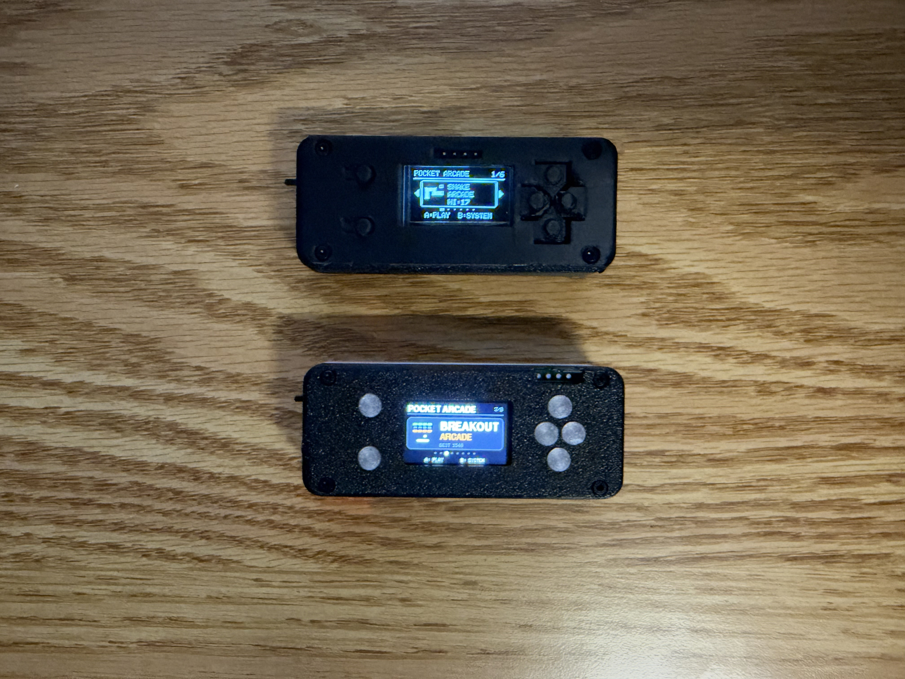
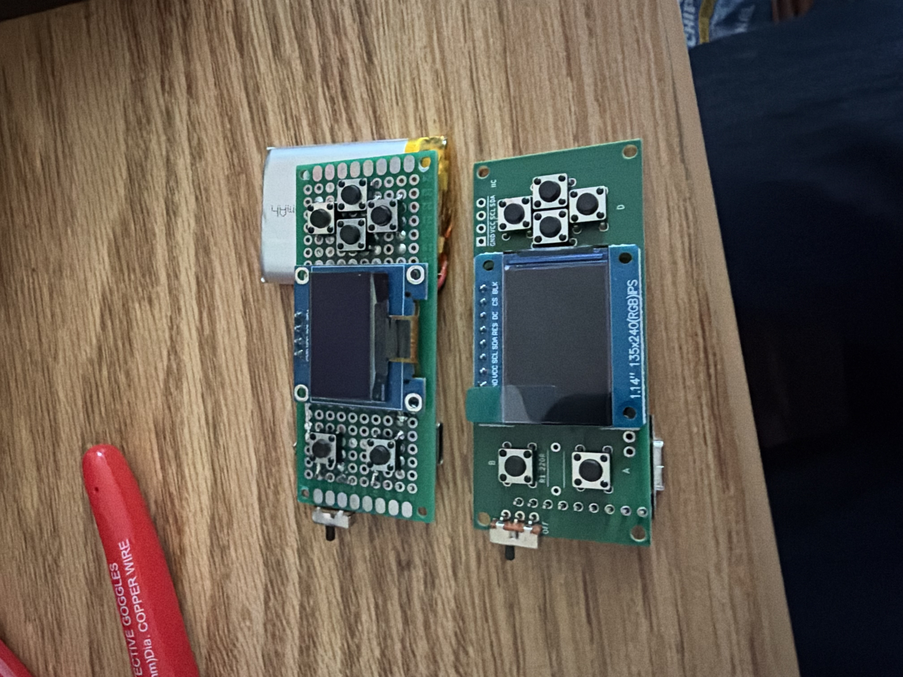
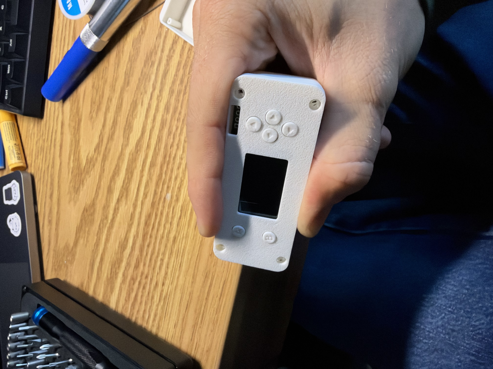
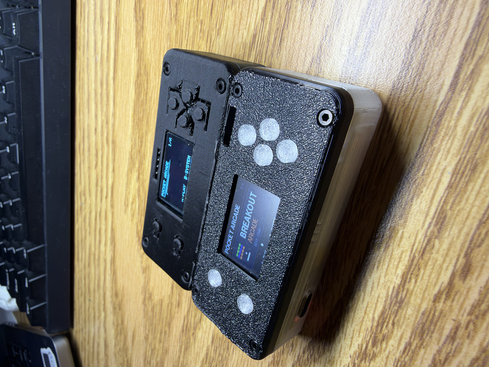
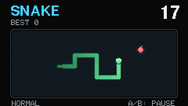
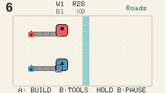
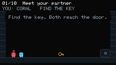

# MiniConsole

**A pocket game console built across embedded software, custom electronics, and physical design.**

[](https://github.com/albash0/MiniConsole/actions/workflows/host-tests.yml)



*Built hardware: the earlier OLED handheld above and the color TFT handheld below. Photograph provided by the project author.*

An ESP32-S3 handheld with six buttons, OLED and color TFT versions, custom carrier PCBs, and a printable enclosure. The library combines arcade games, puzzles, an original traffic-planning implementation, adapted Doom support, and wireless play between two consoles.

A project by [albash0](https://github.com/albash0), a first-year ASEN and CTD student at CU Boulder.

[Engineering notes](docs/ENGINEERING.md) · [Hardware and case files](#hardware) · [Build instructions](docs/BUILD.md) · [Controls](docs/USER_GUIDE.md) · [Validation](VALIDATION.md)

## About the project

MiniConsole began with Snake and portrait Tetris on a 128 × 64 OLED. Extending it to a 240 × 135 color display introduced new memory, rendering, input, and mechanical-fit constraints. Wireless co-op added a second device whose state had to remain consistent with the first.

### From prototype to finished handheld

| Electronics iteration | Enclosure fit test | Assembled generations |
| --- | --- | --- |
|  |  |  |
| OLED protoboard prototype at the top; custom TFT PCB below. | A printed front shell brings together the display opening, button guides, fasteners, and handheld form. | Color TFT version in front; earlier OLED version behind. |

These build photographs show the progression from electronics integration to enclosure fitting and assembled devices. [Photo provenance and metadata handling](docs/media/photos/README.md).

### My project work

| Area | Work in this project | Source and evidence |
| --- | --- | --- |
| Firmware and interaction | Game launcher, six-button navigation, display profiles, themes, sound, and persistent checkpoints | [Main firmware](MiniConsole/MiniConsole.ino), [checkpoint implementation](MiniConsole/SuspendSave.h), [user guide](docs/USER_GUIDE.md) |
| Games and networking | Micro Motorways traffic simulation; Pocket Partners rooms and host-authoritative co-op; Block Battle Tetris mode | [Traffic model](MiniConsole/MotorwaysGame.h), [co-op implementation](MiniConsole/PartnersLink.h), [protocol tests](MiniConsole/tests/partners_test.cpp) |
| Hardware integration | OLED and TFT carrier-board designs, component/pin mapping, and fabrication outputs | [OLED carrier](MiniConsole/PCB/), [TFT carrier](MiniConsole/PCB-TFT114/) |
| Mechanical design | Screen/PCB fit, keyed button guides, and printable plain rear-shell choices | [STEP/STL parts and assembly constraints](hardware/case/) |
| Validation and tooling | Automated game/controller/rendering tests, firmware builds, and documented hardware bring-up | [Test runner](MiniConsole/tests/run_tests.sh), [validation report](VALIDATION.md) |

**Upstream work:** Doom support adapts DIABLITO, descended from RP2040 Doom and Chocolate Doom. The original game engine and assets have their own authors and licenses. My project integrates that engine with the S3, displays, controls, launcher, and saves. The complete adapted source is included under [DiablitoOLED](libraries/DiablitoOLED/); see [credits and licenses](THIRD_PARTY.md).

### Engineering decisions

- **Share game rules across displays:** keep common state and checkpoint formats while allowing native color rendering where it improves the interface.
- **Budget memory explicitly:** a single full-panel RGB565 buffer is 64,800 bytes; the TFT backend attempts PSRAM allocation first.
- **Use one authority for co-op physics:** the host owns the world state; clients send inputs and receive snapshots, with stalls and disconnects handled explicitly.
- **Treat fit as part of the system:** screen height, switch travel, retaining flanges, and battery clearance constrain the enclosure together.

[Read the decisions, source links, regression example, and next measurements →](docs/ENGINEERING.md)

### Status and validation

| Check | Evidence and limits |
| --- | --- |
| Automated tests | **30 host suites per display profile** pass with address/undefined-behavior sanitizers. [GitHub Actions](https://github.com/albash0/MiniConsole/actions). |
| Firmware | OLED and TFT profiles compiled for the public source release. |
| Physical devices | The [build photographs](#from-prototype-to-finished-handheld) show OLED/TFT assemblies and enclosure iteration. Development records document bring-up and nearby two-console co-op/battle testing. The source release itself did not include a new device flash or gameplay run. |
| CAD and fabrication | Editable KiCad designs, BOMs, fabrication files, and individual case parts are supplied. Physical assembly tolerances still need checking. |
| Open measurements | Battery runtime, defined wireless range, and repeatable frame-time comparisons remain to be measured. |

Host tests stub the Doom engine; their success does not establish Doom runtime behavior on hardware. [Validation details](VALIDATION.md).

### Timeline

Dates below come from dated validation notes and source/CAD records; early dates identify the earliest retained files, rather than a reconstructed Git history.

| Date | Milestone |
| --- | --- |
| 2026-10-12 | Earliest retained Snake and Tetris game sources. |
| 2026-10-13 | Breakout, Invaders and ten-level Sokoban; pause/resume checkpoints; DIABLITO-based Doom integration on the OLED console. |
| 2026-10-14 | Custom OLED and 1.14-inch TFT carrier-board design records. |
| 2026-10-16 | Going Out mode: persistent drink counter, configurable goal, and three party games. |
| 2026-10-29 | Color TFT firmware validated on the assembled console, including Doom. |
| 2026-10-30 | Native TFT game presentation and appearance work. |
| 2026-11-05 | Shorter case top selected after a physical test print. |
| 2026-11-09 | Piezo sound, Tetris music, themes, independent music/background controls, and keyed case refinements. |
| 2026-11-10–11 | Micro Motorways: traffic simulation, roads, bridges, express links, endless growth, diagonal roads and junction balancing. |
| 2026-11-12 | Wireless Tetris Block Battle and ten-room Pocket Partners co-op, tested on two TFT consoles. |
| 2026-11-17 | Public source preparation, portable build instructions and privacy review. |


## Games and controls

| Snake | Micro Motorways | Pocket Partners |
| --- | --- | --- |
|  |  |  |

*Host-rendered frames from the firmware's TFT renderer, separate from the physical build photographs above.*

The main library includes **Snake, Tetris, Breakout, Invaders, Sokoban, Doom, Micro Motorways, and Pocket Partners**. Tetris also has a two-console Block Battle mode. Pocket Partners has ten cooperative platform-puzzle rooms, and Sokoban has ten original puzzles.

The TFT version adds native menus, selected native game renderers, themes, and color. Checkpoints, settings, and high scores persist across restarts. Wireless modes use ESP-NOW without a router. Optional Going Out mode includes a drink counter and three party games; it is documented with the [full controls](docs/USER_GUIDE.md).

## Hardware

| Version or part | Files |
| --- | --- |
| OLED carrier V1.7 | [KiCad, Gerbers, BOM and board notes](MiniConsole/PCB/) |
| 1.14-inch ST7789 TFT carrier V1.3 | [KiCad, Gerbers, BOM and board notes](MiniConsole/PCB-TFT114/) |
| Keyed TFT enclosure | [Individual STEP/STL fronts, plain rears and buttons](hardware/case/) |

Both carriers use an ESP32-S3 SuperMini, six buttons, and an optional GPIO4 piezo through 220 Ω. Read the [TFT battery wiring correction](MiniConsole/PCB-TFT114/wiring/README.md) before assembly. The enclosure notes cover the thicker rear's battery-clearance constraint.

## Build and test

[The build guide](docs/BUILD.md) covers dependencies, OLED/TFT selection, first installation, and the separate Doom shareware-data download. Commands below run from the repository root:

```sh
python3 MiniConsole/tools/build_doom.py --display oled
python3 MiniConsole/tools/build_doom.py --display tft
sh MiniConsole/tests/run_tests.sh
DISPLAY_PROFILE=tft sh MiniConsole/tests/run_tests.sh
```

## License and credits

Original software, documentation and design files: **GPL-2.0-or-later**, except retained third-party notices. See [LICENSE](LICENSE) and [THIRD_PARTY.md](THIRD_PARTY.md). DIABLITO, RP2040 Doom, Chocolate Doom, id Software, Adafruit and KiCad contributors retain their credits and licenses. Doom game data is licensed separately.
